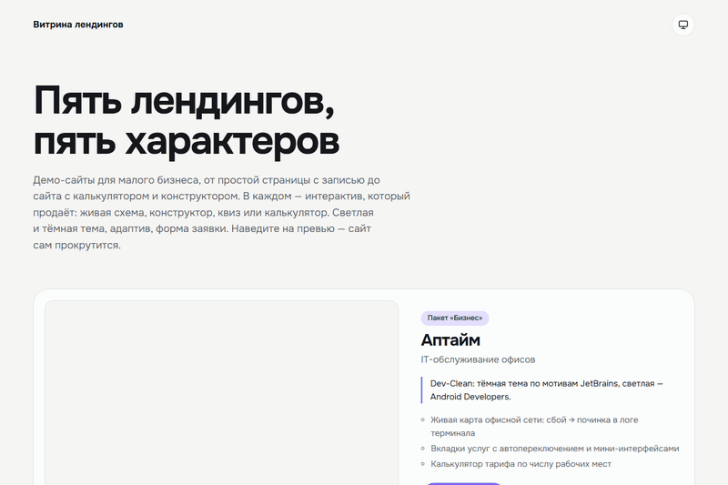
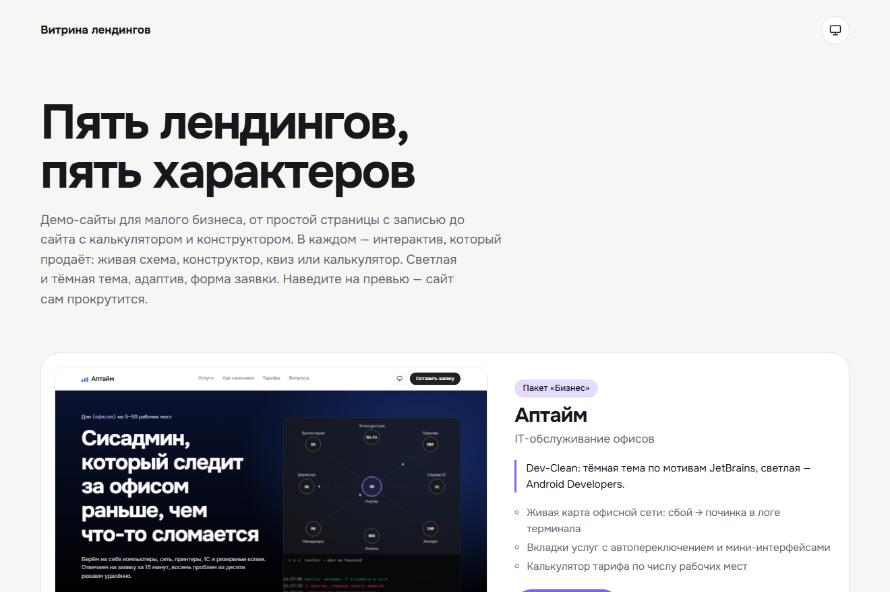
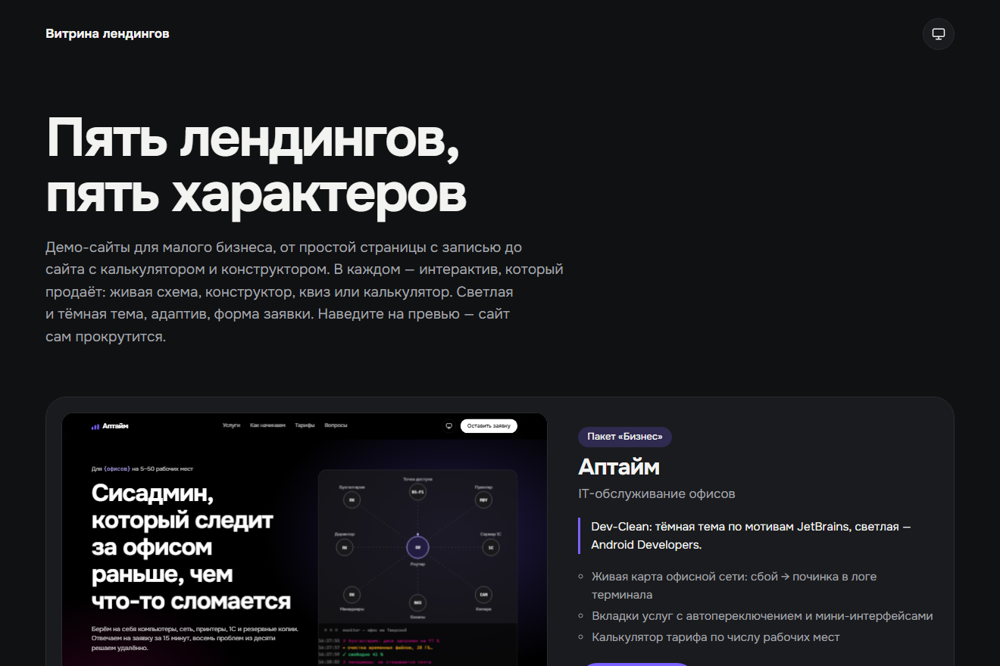

# Витрина лендингов

**Демо:** https://znikdk.github.io/landing-showcase/



Одна страница с живыми превью пяти демо-лендингов. Каждый лендинг — отдельный репозиторий со своей страницей на GitHub Pages. Наведите на превью — сайт внутри сам прокрутится.

| Сайт | Ниша | Пакет | Стиль | Демо | Код |
|---|---|---|---|---|---|
| Аптайм | IT-обслуживание офисов | Бизнес | Dev-Clean (JetBrains / Android Developers) | [открыть](https://znikdk.github.io/landing-it-service/) | [landing-it-service](https://github.com/ZniKDK/landing-it-service) |
| Стебель | Цветочная мастерская | Бизнес | Ризография | [открыть](https://znikdk.github.io/landing-flowers/) | [landing-flowers](https://github.com/ZniKDK/landing-flowers) |
| Зелёная волна | Автошкола | Бизнес | Дорожные указатели | [открыть](https://znikdk.github.io/landing-driving-school/) | [landing-driving-school](https://github.com/ZniKDK/landing-driving-school) |
| Прораб и сыновья | Ремонт квартир | Стандарт | Чертёж | [открыть](https://znikdk.github.io/landing-renovation/) | [landing-renovation](https://github.com/ZniKDK/landing-renovation) |
| Чистый хвост | Груминг-салон | Эконом | Мягкий пастельный | [открыть](https://znikdk.github.io/landing-grooming/) | [landing-grooming](https://github.com/ZniKDK/landing-grooming) |

Ещё один лендинг со сборкой на Eleventy и отправкой заявок в Telegram через Yandex Cloud Functions — [landing-demo](https://github.com/ZniKDK/landing-demo).

## Скриншоты

| Светлая тема | Тёмная тема |
|---|---|
|  |  |

## Что общего у всех

- Светлая и тёмная тема плюс режим «как в системе».
- Адаптив от 360 px, учёт настройки «уменьшить движение».
- Главный интерактив под нишу: живая схема, конструктор, квиз, калькулятор.
- Иллюстрации нарисованы кодом (SVG и CSS), без фото и сторонних JS-библиотек.
- Данные клиента вынесены в `config.js` — шаблон быстро перенастраивается под нового заказчика.

## Запуск

```bash
python -m http.server 8000
```

Превью подгружаются с GitHub Pages, поэтому нужен интернет.
